# 微信表情包制作 Skill

在 Codex 中制作或修改微信静态表情和动态 GIF。技能覆盖专辑类型、画风与文字位置选择、逐款文案、角色绘制、动作分镜、导出、五张上架配图和规格检查。

## 安装

1. 克隆仓库，或在 GitHub 选择 **Code → Download ZIP** 后解压。
2. 在项目根目录的 `.agents/skills/` 内创建 `wechat-gif-stickers` 文件夹。
3. 将本仓库的 `SKILL.md`、`agents/` 和 `assets/` 复制到该文件夹。用 Codex 打开项目，并在对话中调用 `$wechat-gif-stickers`。

## 使用示例

- `$wechat-gif-stickers 帮我做一套小猫办公动态表情包，画风选复古像素，文字随动作编排。`
- `$wechat-gif-stickers 检查这套已有 GIF 的规格，并帮我设计五张上架配图。`

提供参考图时，可以说明要沿用角色、画风或构图。制作新专辑时，也可以让技能根据主题推荐类型、画风和文字位置。

## 动态案例

同一组四句文案在 20 种画风下的 GIF 效果。

| 画风 | 你好 | 收到 | 哈哈哈 | 给你心心 |
| --- | --- | --- | --- | --- |
| 软萌手绘 |  |  |  |  |
| 搞怪线条 |  |  |  |  |
| 复古像素 |  | 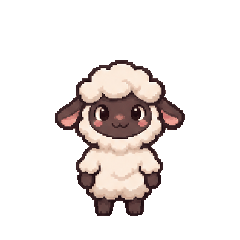 |  | 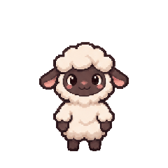 |
| Q版漫画 |  |  |  |  |
| 立体黏土 | 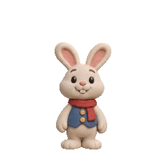 | 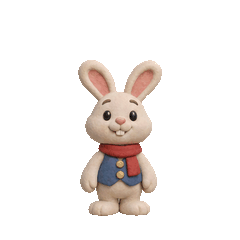 | 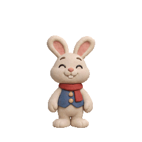 | 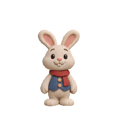 |
| 国风插画 |  |  |  |  |
| 水彩绘本 |  |  |  |  |
| 蜡笔涂鸦 |  |  |  |  |
| 扁平矢量 |  |  |  |  |
| 黑白线稿 |  |  |  |  |
| 美式复古漫画 |  |  |  |  |
| 日系治愈插画 | 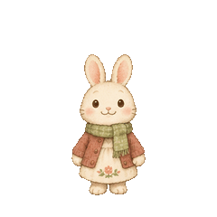 | 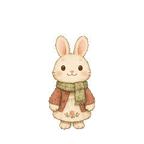 |  | 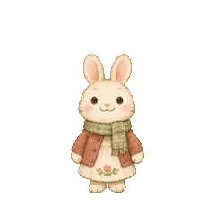 |
| 韩系简笔贴纸 |  |  |  |  |
| 剪纸拼贴 | 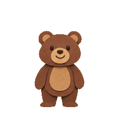 | 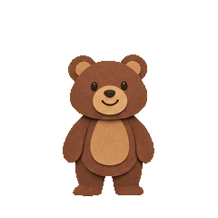 | 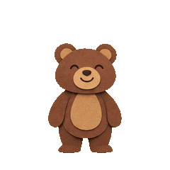 | 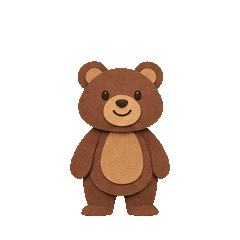 |
| 毛毡布偶 | 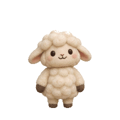 | 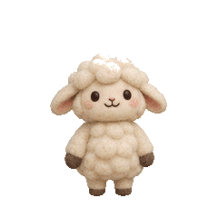 | 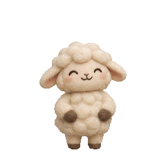 | 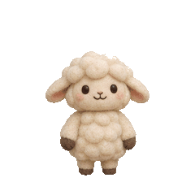 |
| 3D潮玩 |  |  |  |  |
| 霓虹赛博 |  | 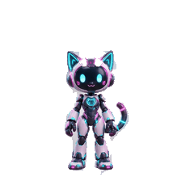 |  | 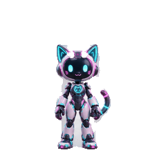 |
| 复古海报 |  |  | 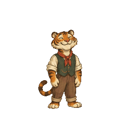 | 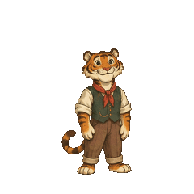 |
| 港式茶餐厅插画 |  |  |  |  |
| 表情符号风 |  |  |  |  |
